# Course Registration – Quản lý trạng thái với Provider & ChangeNotifier

Ứng dụng mẫu **Đăng ký học phần (Course Registration)** được xây dựng bằng **Flutter (Material 3)** cho môn học **Lập trình đa nền tảng**, nhằm minh họa trực quan và chuyên sâu về chủ đề **"Quản lý trạng thái (State Management) với Provider và ChangeNotifier"**.

---

## 👥 Thành viên nhóm & Phân công nhiệm vụ

| Thành viên | Vai trò & Nhiệm vụ thực hiện | Nhánh Git |
| :--- | :--- | :--- |
| **Đặng Công Thắng** | • Thiết kế kiến trúc tổng thể, model (`Course`), danh mục học phần (`courseCatalog`).<br>• Cài đặt logic nghiệp vụ & quản lý state trung tâm (`RegistrationNotifier`).<br>• Xây dựng màn chính (`CourseListScreen`), màn học phần đã đăng ký (`RegisteredScreen`).<br>• Tách các widget thành phần (`CourseTile`, `CreditBadge`, `SummaryBar`).<br>• Bảng điều khiển demo (`DemoPanel`, `_NotifyLog`) & hoàn thiện `README.md`. | `thang` |
| **<Họ tên đầy đủ của Thái>** | • Xây dựng màn hình thực nghiệm chuyên sâu **Provider Lab** (`ProviderLabScreen`).<br>• Cài đặt `LabNotifier` và bộ theo dõi rebuild trực quan (`RebuildTracker`).<br>• Trực quan hóa so sánh số lần rebuild: `setState`, `context.watch`, `Consumer`, `context.select`, `context.read` qua chip `Build: n`. | `thai` |

---

## 📌 Bảng tra cứu: Khái niệm → Vị trí trong Code

| Khái niệm / Kỹ thuật | File nguồn | Mô tả & Mục đích sử dụng trong dự án |
| :--- | :--- | :--- |
| **ChangeNotifier & notifyListeners()** | `lib/notifiers/registration_notifier.dart` | Lớp quản lý trạng thái kế thừa `ChangeNotifier`. Mọi logic nghiệp vụ (kiểm tra 14–24 TC, chống trùng môn) nằm tại đây. Chỉ gọi `notifyListeners()` khi state thật sự thay đổi. |
| **ChangeNotifierProvider (Toàn cục)** | `lib/main.dart` | Bọc ngoài cùng quanh `MaterialApp` để cung cấp thể hiện duy nhất của `RegistrationNotifier` cho tất cả các màn hình (`CourseListScreen`, `RegisteredScreen`). |
| **ChangeNotifierProvider (Cục bộ)** | `lib/lab/provider_lab_screen.dart` | Bọc riêng cho màn hình Lab với `LabNotifier`. State tự động giải phóng (`dispose()`) khi người dùng thoát khỏi màn hình (pop Navigator). |
| **context.watch** | `lib/widgets/credit_badge.dart`<br>`lib/views/registered_screen.dart` | Đăng ký widget làm listener; tự động kích hoạt rebuild toàn bộ widget khi `notifyListeners()` được gọi (dùng cho badge tín chỉ trên AppBar và danh sách đã đăng ký). |
| **Consumer** | `lib/widgets/summary_bar.dart`<br>`lib/lab/provider_lab_screen.dart` | Lắng nghe thay đổi nhưng cô lập phạm vi rebuild chỉ trong hàm `builder`, tối ưu hiệu năng render giao diện (dùng tham số child cho phần tĩnh). |
| **context.select** | `lib/widgets/course_tile.dart`<br>`lib/lab/provider_lab_screen.dart` | Chỉ lắng nghe một phần dữ liệu cụ thể (`isRegistered(id)`). Widget chỉ rebuild khi giá trị được chọn thay đổi, bỏ qua các thay đổi khác. |
| **context.read** | Các nút bấm trong `CourseTile`, `RegisteredScreen`, `DemoPanel`, `ProviderLabScreen` | Truy xuất Notifier để gọi phương thức thực thi (`register`, `unregister`, `clearAll`) mà KHÔNG đăng ký lắng nghe rebuild. |
| **addListener & removeListener** | `lib/widgets/demo_panel.dart` (`_NotifyLog`) | Minh họa cơ chế nền tảng của `ChangeNotifier`. Provider thực chất sử dụng cơ chế `addListener` này bên dưới để kích hoạt widget rebuild. |
| **Tách biệt UI / State / Nghiệp vụ** | • UI: `lib/views/`, `lib/widgets/`<br>• State & Logic: `lib/notifiers/`<br>• Data & Model: `lib/models/`, `lib/data/` | Áp dụng Separation of Concerns: Widget hoàn toàn không chứa logic tính toán tín chỉ hay kiểm tra điều kiện; mọi tính toán do Notifier đảm nhiệm. |

---

## 📂 Cấu trúc thư mục `lib/`

```text
lib/
├── data/
│   └── course_catalog.dart             # Danh mục 10 học phần mẫu ĐH Bách Khoa (2–4 tín chỉ, tổng 30 TC)
├── lab/
│   ├── lab_notifier.dart               # Notifier riêng phục vụ thực nghiệm đo đếm rebuild
│   ├── provider_lab_screen.dart        # Màn hình so sánh trực quan setState vs các cách dùng Provider
│   └── rebuild_tracker.dart            # Tiện ích đếm số lần hàm build() được gọi
├── models/
│   └── course.dart                     # Model học phần (id, code, name, credits, lecturer - immutable)
├── notifiers/
│   └── registration_notifier.dart      # Quản lý danh sách đăng ký, tổng tín chỉ (min 14, max 24), trạng thái
├── views/
│   ├── course_list_screen.dart         # Màn hình chính danh sách học phần kèm DemoPanel
│   └── registered_screen.dart          # Màn hình danh sách học phần đã đăng ký (đồng bộ 2 chiều)
├── widgets/
│   ├── course_tile.dart                # Thẻ từng môn học (context.select theo dõi trạng thái, context.read xử lý nút)
│   ├── credit_badge.dart               # Huy hiệu tổng tín chỉ trên AppBar (context.watch)
│   ├── demo_panel.dart                 # Bảng điều khiển kịch bản demo + Nhật ký notifyListeners (addListener)
│   └── summary_bar.dart                # Thanh tiến độ và trạng thái ở chân màn hình (Consumer)
└── main.dart                           # Điểm khởi chạy app, bọc ChangeNotifierProvider toàn cục
```

---

## 🚀 Hướng dẫn cài đặt & Chạy ứng dụng

### 1. Cài đặt thư viện dependencies:
```bash
flutter pub get
```

### 2. Chạy ứng dụng:
- Trên thiết bị Android (hoặc giả lập Android):
  ```bash
  flutter run
  ```
- Hoặc chạy thử nghiệm trên Windows / Chrome:
  ```bash
  flutter run -d windows
  # hoặc
  flutter run -d chrome
  ```

### 3. Chạy toàn bộ Unit & Widget Tests:
```bash
flutter test
```
*(Tất cả 5 unit test cho RegistrationNotifier + 2 widget test (khởi chạy app, kịch bản DemoPanel) đều đã vượt qua 100%).*

---

## 📸 Hình ảnh Demo ứng dụng thực tế & Provider Lab

### 1. Màn hình chính & Tương tác đa chiều (1 thao tác, 3 vị trí cùng cập nhật)
| Ban đầu (Chưa chọn môn: 0/24 TC) | Đăng ký 1 môn (3/24 TC: AppBar, nút & thanh tiến độ cùng đổi) |
| :---: | :---: |
| 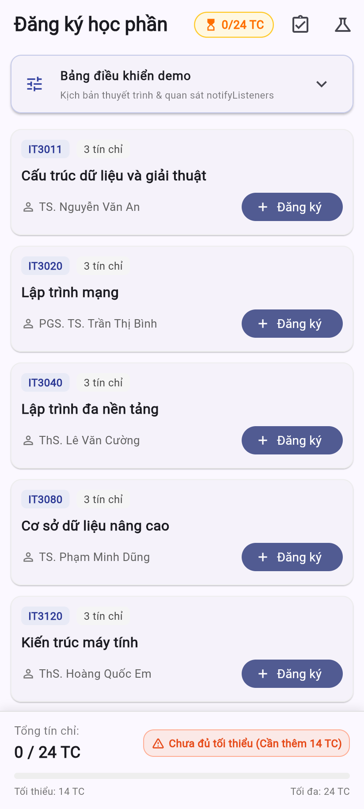 | 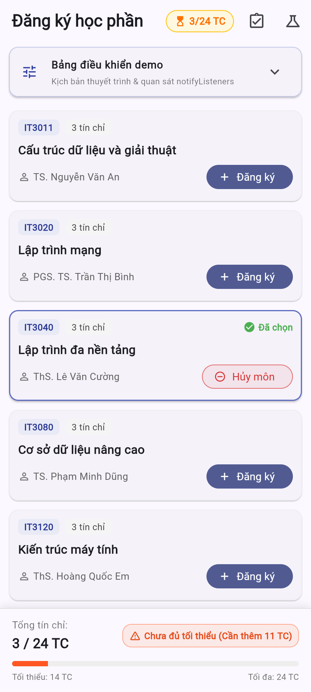 |

---

### 2. Bảng điều khiển Demo (DemoPanel) – Kiểm chứng các kịch bản biên
| Đăng ký đủ tối thiểu (≥ 14 TC - Hợp lệ) | Vượt giới hạn tối đa 24 TC (SnackBar đỏ) | Đăng ký trùng (SnackBar cam, nhật ký không tăng) |
| :---: | :---: | :---: |
| 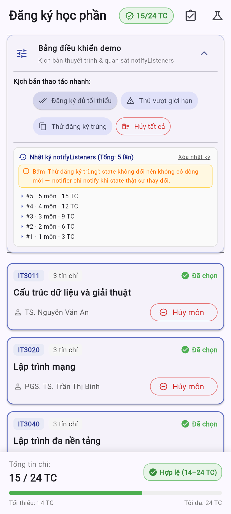 | 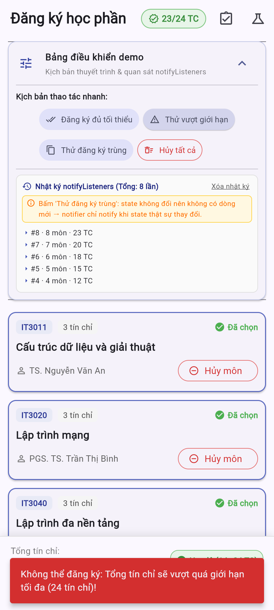 | 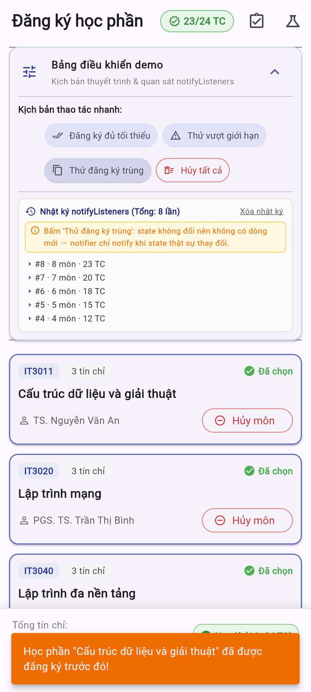 |

---

### 3. Đồng bộ trạng thái liên màn hình (Dùng chung 1 Instance State duy nhất)
| Màn hình học phần đã đăng ký (23/24 TC) | Hủy môn & Back về màn hình chính (Tự đồng bộ còn 20 TC) |
| :---: | :---: |
| 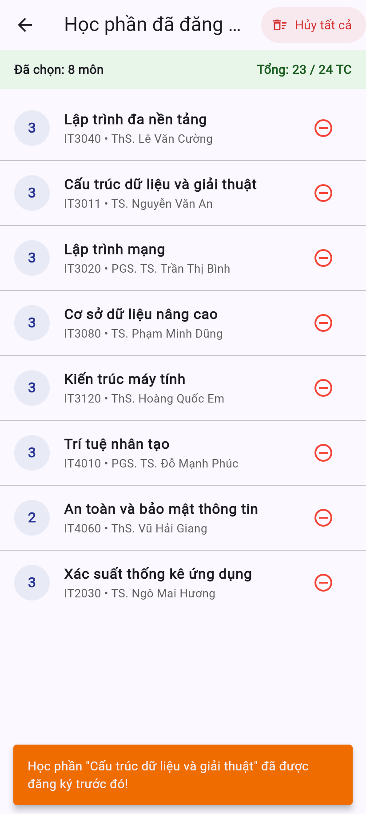 | 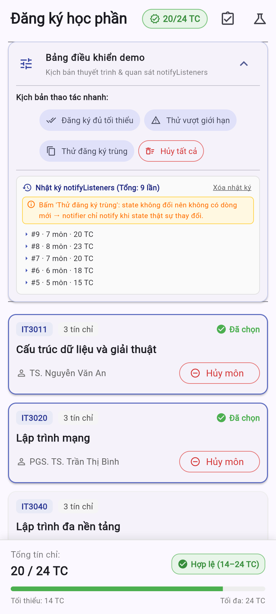 |

---

### 4. Phòng thí nghiệm Provider Lab (Trực quan hóa số lần Rebuild)

#### a) So sánh trực tiếp: `setState` vs `Provider`
| Ban đầu (Tất cả Build: 1) | Bấm tăng Khối A (setState làm cả cha, con, số đều Build: 4) | Bấm tăng Khối B (Provider chỉ làm số Build: 4, cha và con tĩnh giữ Build: 1) |
| :---: | :---: | :---: |
| 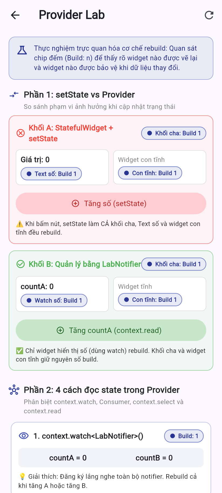 | 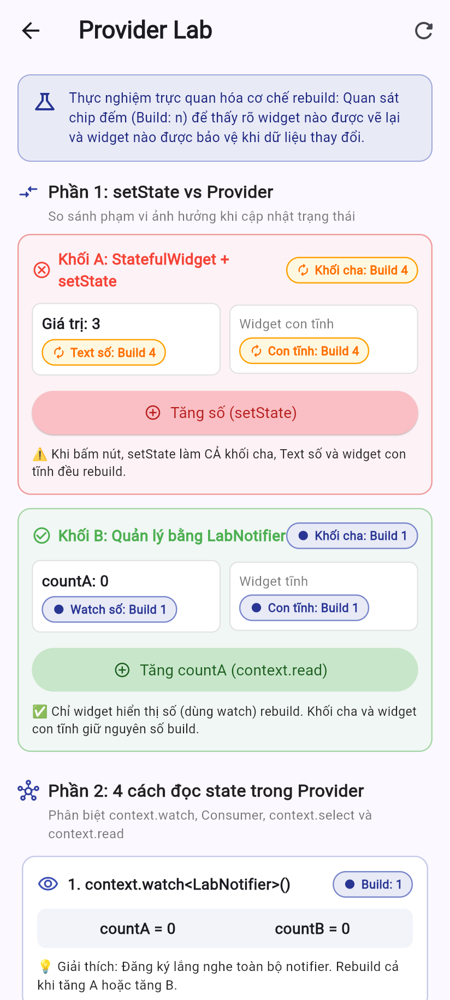 | 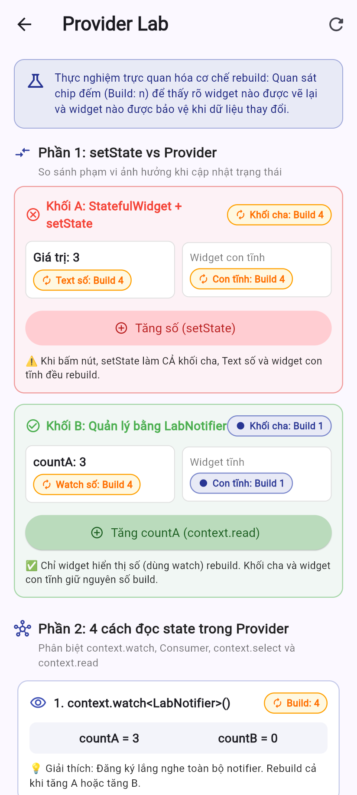 |

#### b) Đo số lần rebuild của 4 cách đọc State & Nút Reset
| Đo 4 cách đọc state sau khi tăng B (watch=6, Consumer=6, select=4, read=1) | Nút "Đặt lại bộ đếm build" (Đưa toàn bộ chip về Build: 1) |
| :---: | :---: |
| 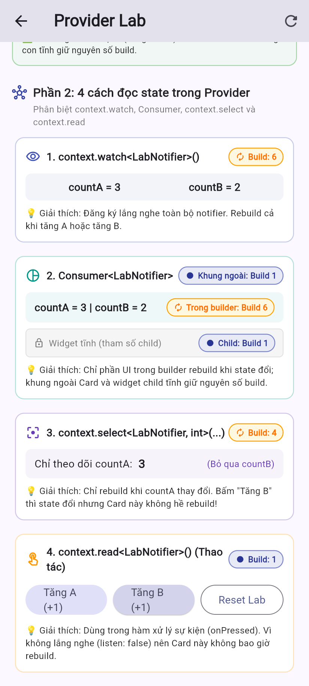 | 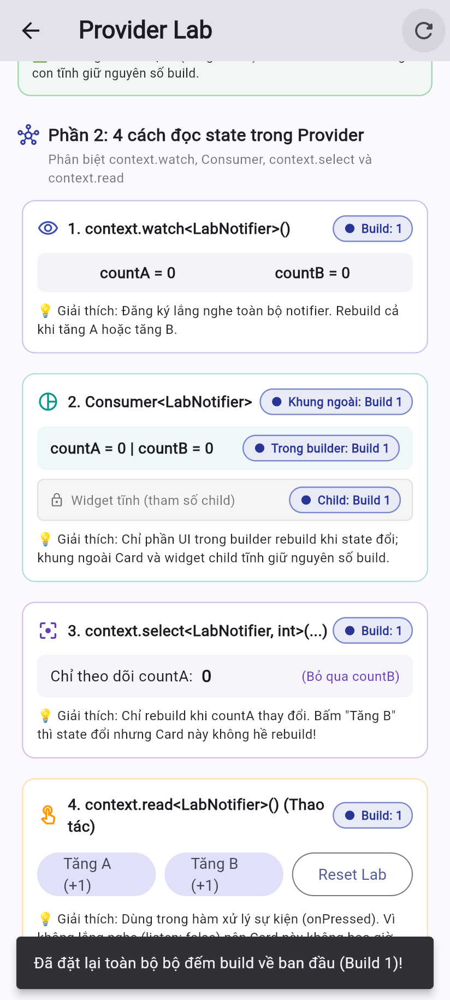 |
